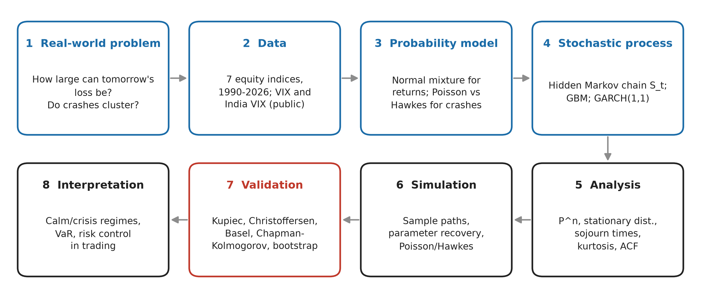

# Volatility Regimes, Crash Clustering and Value-at-Risk

**Applied Stochastic Modelling course project.** Daily stock returns are close to unpredictable, but
their *risk* is not: markets switch between a calm and a crisis state. We model that switching as a
**hidden Markov chain**, test whether market crashes arrive as a **Poisson process**, check the
theory against **simulation**, and use the models to forecast the **one-day 99% Value-at-Risk
(VaR)** out of sample on NIFTY 50 and six other world indices (1990-2026).



---

## Start here

| I want to... | Go to |
|---|---|
| **Read every result** (numbers, tables, pass/fail scorecard of 50 studies) | [`final_results/README.md`](final_results/README.md) |
| **Write the report or the slides** (course structure, draft text, derivations, which figure to use) | [`REPORT_GUIDE.md`](REPORT_GUIDE.md) |
| **See the simulations** (Markov chain, Poisson vs Hawkes, sample paths, parameter recovery) | [`final_results/14_simulations/README.md`](final_results/14_simulations/README.md) |
| **Get the figures** for the report (300 dpi, one folder) | [`final_results/13_report_figures/`](final_results/13_report_figures/) |
| **Download any CSV** straight into Python | [`final_results/CSV_INDEX.md`](final_results/CSV_INDEX.md) |
| **Find one specific result** | [Where to find what](#where-to-find-what) below |
| **Understand a code file** | [Code: every file explained](#code-every-file-explained) below |
| **Rerun something** | [Reproduce](#reproduce) below (not needed to read results) |

Nothing needs to be rerun: every output is saved in [`final_results/`](final_results/).

---

## Main results in one minute

| Finding | Evidence |
|---|---|
| Returns are not normal and volatility clusters | NIFTY excess kurtosis 15.9; autocorrelation of squared returns significant (Ljung-Box p = 0) |
| Two persistent regimes in every market | Calm stays ~111 days, crisis ~23 days (NIFTY); crisis 2.4-3.2x as volatile; 90-100% of crash days fall in the crisis regime, in all 7 markets |
| Markov-chain theory holds | Closed-form P^n, stationary distribution (17% crisis) and stay lengths confirmed by 10,000 simulated chains (error < 0.011) |
| Crash days are **not** a Poisson process | Variance/mean of yearly counts 17.6 (Poisson: 1); 44% of gaps between crashes are 5 days or less (Poisson: 8%); a Hawkes self-exciting process fits far better (LR = 160) |
| The hidden chain explains crash clustering | Chapman-Kolmogorov check passes at 94% of horizons (observed Markov chain: 44%, Poisson: 41%) |
| Regime models give the best VaR | NIFTY 50: HMM 0.92% violations, passes both tests; seven markets: HMM-gated GARCH has the fewest violations in 6 of 7 and the fewest Basel red-zone years (2, vs 33 for the random walk) |
| Main limitation | Normal errors inside each regime are too thin-tailed (HMM kurtosis 4.8 vs 15.9 in the data): no model gets exactly 1% over 30+ years |
| Practical use | In trading, the forecasts cut crisis losses by 54-70%, but do not significantly raise risk-adjusted returns |

---

## Repository map

```
ASM_PROJECT/
├── README.md                  this file: what is what, and where to find it
├── REPORT_GUIDE.md            report and presentation guide, following the course structure
├── requirements.txt           Python packages (Python 3.11)
│
├── final_results/             EVERY RESULT, ready to read (no rerun needed)
│   ├── README.md              all numbers and tables, master scorecard (50 studies)
│   ├── CSV_INDEX.md           every CSV with a direct-download link
│   ├── MANIFEST.csv           every file: size, original path, description
│   ├── 00_input_data/         daily prices: 7 indices, VIX, India VIX, NSE NIFTY 1990-2026
│   ├── 01_stylized_facts/     fat tails, volatility clustering, VIX check
│   ├── 02_nifty_model_comparison/  six VaR models on NIFTY 50; full-sample HMM; 2 vs 3 states
│   ├── 03_extreme_events_poisson_hawkes/  Poisson dispersion test, Hawkes fit
│   ├── 04_hmm_simulation_study/   first parameter-recovery study (hmmlearn)
│   ├── 05_seven_market_var_backtest/  6 models x 7 markets, daily VaR paths
│   ├── 06_forecast_skill_and_runtime/ tick loss, Diebold-Mariano, run time
│   ├── 07_regimes_and_transitions/    regimes, transition matrices, daily regime flags
│   ├── 08_chapman_kolmogorov/         n-step Markov check
│   ├── 09_crisis_timing_and_length/   crisis labels vs bear markets, NBER, dated events
│   ├── 10_trading_applications/       options (selling volatility) and volatility targeting
│   ├── 11_nse_data_experiments/       official NSE data back to 1990; data audits
│   ├── 12_run_logs/                   logs and console output of every run; unit tests
│   ├── 13_report_figures/             all report figures in one folder (300 dpi)
│   └── 14_simulations/                ALL SIMULATIONS: data, figures, theory comparison
│       ├── markov_chain/              n-step probabilities, stay lengths
│       ├── poisson_hawkes/            1,000 Poisson vs 1,000 Hawkes paths
│       ├── return_paths/              GBM, GARCH, HMM sample paths; kurtosis and ACF
│       └── parameter_recovery/        our EM on 100 simulated samples
│
├── src/                       all model, test and study code (described below)
├── scripts/                   NSE data experiments (Exp 1 and Exp 2)
├── notebooks/01_stylized_facts.py   stylized facts, run as a script
├── tests/                     43 unit tests
├── data/
│   ├── raw/                   downloaded prices (Yahoo files gitignored; copies in final_results/00_input_data)
│   │   ├── official_nse/      NSE NIFTY files by year, 1990-2026
│   │   └── extended/          extended downloads and manifest
│   └── processed/             nifty50_nse_1990_2026.csv (audited NSE series)
├── reports/                   working outputs written by the scripts (copied into final_results/)
│   ├── figures/               stylized-fact figures; exp1_exp2/ figures
│   ├── multi_market/          seven-market CSVs, logs, figures, FINDINGS.md
│   ├── single_market/         saved console output of the single-market studies
│   ├── report_figures/        RF01-RF13 and their numbers
│   ├── simulations/           simulated data (copied to final_results/14_simulations)
│   ├── audits/                NSE vs Yahoo audits
│   └── reproducibility/       Exp 1/2 loss comparison
└── results/                   Exp 1 and Exp 2 forecast files (NSE data)
```

---

## Where to find what

| Looking for | File |
|---|---|
| NIFTY summary statistics, Jarque-Bera, Ljung-Box, VIX correlation | `final_results/01_stylized_facts/stylized_facts_output.txt` |
| NIFTY VaR backtest table (6 models) | `final_results/02_nifty_model_comparison/model_comparison_output.txt` |
| Fitted HMM parameters, 2 vs 3 states (BIC) | `final_results/02_nifty_model_comparison/hmm_regime_output.txt`; `13_report_figures/report_numbers.json` (`hmm_fit`) |
| Crash days per year, Poisson test, Hawkes fit | `final_results/03_extreme_events_poisson_hawkes/extremes_output.txt` |
| Violations, Kupiec, Christoffersen, Basel zones, sub-periods (every market and model) | `final_results/05_seven_market_var_backtest/ALL_backtest.csv` |
| Daily VaR forecast and violation flag, every model | `final_results/05_seven_market_var_backtest/<market>_var_paths.csv` |
| Tick loss, skill vs GBM, Diebold-Mariano | `final_results/06_forecast_skill_and_runtime/ALL_forecast_skill.csv` |
| Run time per model | `final_results/06_forecast_skill_and_runtime/ALL_timings.csv` |
| Transition matrices, expected stays, stationary shares (7 markets) | `final_results/07_regimes_and_transitions/ALL_transition_matrices.csv` |
| Daily filtered P(crisis) and regime flags | `final_results/07_regimes_and_transitions/<market>_regime_flags.csv` |
| Crisis share, crash days in crisis, regime volatilities | `final_results/07_regimes_and_transitions/ALL_regimes.csv` |
| Coverage of each documented crisis window | `final_results/07_regimes_and_transitions/ALL_crisis_windows.csv` |
| Chapman-Kolmogorov results | `final_results/08_chapman_kolmogorov/CK_summary.csv` (per horizon: `CK_crash_days.csv`, `CK_regime_flags.csv`) |
| Bear markets, NBER recessions, event dates vs crisis labels | `final_results/09_crisis_timing_and_length/VALIDATION_*.csv` |
| Options and volatility-targeting results | `final_results/10_trading_applications/TRADE_*.csv` |
| NSE data experiments | `final_results/11_nse_data_experiments/` |
| Unit test results | `final_results/12_run_logs/pytest_output.txt` |
| n-step probabilities, theory vs simulation | `final_results/14_simulations/markov_chain/nstep_theory_vs_simulation.csv` |
| Stay lengths, theory vs simulation vs observed | `final_results/14_simulations/markov_chain/sojourn_theory_vs_simulation.csv`, `observed_stays_viterbi.csv` |
| Inter-arrival gaps, yearly crash counts | `final_results/14_simulations/poisson_hawkes/observed_*.csv` |
| Poisson and Hawkes simulation results | `final_results/14_simulations/poisson_hawkes/simulated_paths_summary.csv` |
| Simulated return paths (GBM, GARCH, HMM) | `final_results/14_simulations/return_paths/simulated_return_paths.csv` |
| Kurtosis and ACF: data vs theory vs simulation | `final_results/14_simulations/return_paths/simulation_stats.csv`, `acf_squared_returns.csv` |
| Parameter recovery with our EM | `final_results/14_simulations/parameter_recovery/` |
| Every theory/simulation number in one file | `final_results/13_report_figures/report_numbers.json` |
| Every figure for the report | `final_results/13_report_figures/` |
| Pass/fail of every study | `final_results/README.md`, section "Master scorecard" |

---

## Code: every file explained

Every forecast uses only data before its date (no look-ahead). Run any module from the project
root with `python -m src.<name>`.

### Data

| File | What it does | Output |
|---|---|---|
| `src/loaders.py` | Downloads daily prices from Yahoo Finance (NIFTY 50, S&P 500, India VIX, ...) and caches them as CSV | `data/raw/*.csv` |
| `src/returns.py` | Log returns, annualisation, rolling volatility, summary statistics (incl. Jarque-Bera) | used by all |
| `src/extended_loaders.py` | Independent loaders for the extended history (NIFTY 50 and S&P 500 from 1990, full India VIX history), never overwriting files | `data/raw/extended/` |

### Models

| File | Model | Key functions |
|---|---|---|
| `src/gbm.py` | Geometric Brownian motion (random walk): MLE fit, exact simulation, normal VaR and ES | `fit_gbm`, `simulate_gbm_paths`, `parametric_var` |
| `src/garch.py` | GARCH(1,1) with normal errors (`arch` package), rolling one-day forecasts | `fit_garch`, `make_garch_forecast_fn` |
| `src/hmm.py` | 2-state Gaussian hidden Markov model: fit, **our own forward filter**, Viterbi path, BIC, mixture VaR, rolling forecasts | `fit_gaussian_hmm`, `filtered_state_probs`, `viterbi_regimes`, `bic`, `make_hmm_forecast_fn` |
| `src/em_hmm.py` | **Our own Baum-Welch (EM) estimator** for the Gaussian HMM (scaled forward-backward, closed-form M-step). Matches hmmlearn exactly once hmmlearn's default prior is removed | `fit_em`, `forward_backward` |
| `src/msgarch.py` | 2-regime Markov-switching GARCH (Haas et al. 2004) with the Hamilton filter | `fit_msgarch`, `make_msgarch_forecast_fn` |
| `src/hmm_garch.py` | HMM-gated GARCH: in the crisis regime, volatility = max(HMM crisis volatility, GARCH volatility) | `gated_forecast`, `make_hmm_garch_forecast_fn` |
| `src/extremes.py` | Crash days (log return <= -3%): Poisson dispersion test, Hawkes MLE (exponential kernel), likelihood-ratio test | `poisson_fit_and_dispersion_test`, `fit_hawkes` |

### Simulation

| File | What it does |
|---|---|
| `src/simulators.py` | **All simulators and theory formulas**: Markov chain, Gaussian HMM, GARCH(1,1) and Hawkes (Ogata thinning) simulators; closed-form P^n; mixture moments; HMM autocorrelation of squared returns |
| `src/report_figures.py` | Runs every simulation (10,000 chains, 2,000,000-day chain, 1,000 Poisson + 1,000 Hawkes paths, 300-500 return paths per model, 100-sample parameter recovery), saves the simulated data to `reports/simulations/` and draws RF01-RF13 |
| `src/simulation_study.py` | First parameter-recovery study (50 samples, hmmlearn defaults) |

### Backtesting and validation

| File | What it does | Output |
|---|---|---|
| `src/var_backtest.py` | Rolling out-of-sample backtest for any model; Kupiec, Christoffersen, Basel traffic light; historical-simulation VaR | used by all backtests |
| `src/model_comparison.py` | All six models on NIFTY 50, side by side | console (saved in `02_nifty_model_comparison/`) |
| `src/multi_market.py` | Six models x seven markets with caching and run-time logging; regime study; `--aggregate` builds the cross-market tables | `reports/multi_market/` |
| `src/regime_transitions.py` | Fitted and empirical transition matrices for every market | `ALL_transition_matrices.csv` |
| `src/chapman_kolmogorov.py` | Chapman-Kolmogorov check, horizons 1-40, block-bootstrap bands: crash days (Poisson vs observed chain vs HMM) and regime flags | `CK_*.csv`, fig11 |
| `src/crisis_validation.py` | Crisis labels vs 83 bear markets, NBER recessions and dated events | `VALIDATION_*.csv` |
| `src/crisis_duration.py` | Crisis length vs bear-market length | `VALIDATION_crisis_duration.csv` |
| `src/trading_applications.py` | Options trade (sell one-month variance at VIX / India VIX) and volatility targeting, with pre-set pass criteria | `TRADE_*.csv`, fig12-13 |

### Figures and packaging

| File | What it does |
|---|---|
| `notebooks/01_stylized_facts.py` | Stylized facts of NIFTY 50 and figures 01-05 (runs as a script) |
| `src/make_multi_market_figures.py` | Seven-market figures fig01-fig10 (300 dpi) |
| `src/report_figures.py` | Report figures RF01-RF13 (300 dpi) and `report_numbers.json` |
| `src/collect_results.py` | Copies every output into `final_results/`, writes `MANIFEST.csv` and `CSV_INDEX.md` |

### NSE data experiments (Exp 1 and Exp 2)

| File | What it does |
|---|---|
| `scripts/download_extended_data.py` | Downloads the extended history |
| `scripts/prepare_exp1_exp2.py` | Prepares data and trading calendars (no fitting) |
| `scripts/run_exp1_exp2.py`, `scripts/run_priority_exp1_exp2.py` | Runs the experiments: same evaluation window, different training starts (1990, 1996, 2008, 2009) |
| `scripts/validate_exp1_exp2.py` | Validates every output (alignment, refit schedules, no look-ahead) |
| `scripts/loss_comparison_exp1_exp2.py` | Pinball and FZ0 losses with paired bootstrap |
| `scripts/visualize_exp1_exp2_fixed.py` | Exp 1/2 figures (`reports/figures/exp1_exp2/`) |
| `scripts/show_priority_results.py` | Prints the summary table |
| `src/exp/` | Experiment configuration, calendar handling, runner |

### Tests (`tests/`, 43 tests, all pass)

| File | Checks |
|---|---|
| `test_gbm.py` | GBM parameter recovery; VaR and ES formulas; backtest harness has no look-ahead |
| `test_em_hmm.py` | Our EM recovers parameters, never decreases the likelihood, matches hmmlearn |
| `test_msgarch.py`, `test_hmm_garch.py` | MS-GARCH reduces to the HMM as a special case, incremental filter, parameter recovery; gate rule |
| `test_chapman_kolmogorov.py` | A true Markov chain passes the check; P^(m+n) = P^m P^n; HMM crash probability decays to the base rate |
| `test_trading_applications.py` | Variance-swap payoff, drawdowns, bootstrap test |
| `test_exp_calendar.py`, `test_exp_runner.py`, `test_extended_loaders.py` | NSE experiment calendar, runner, loaders |

---

## The models and tests (summary)

| Model | Stochastic process | Estimation |
|---|---|---|
| GBM / random walk | i.i.d. normal log returns | Closed-form MLE |
| GARCH(1,1) | Variance driven by yesterday's shock and variance | Quasi-MLE |
| 2-state HMM | Hidden Markov chain {calm, crisis}; normal returns within each state | Baum-Welch EM (own code + hmmlearn) |
| MS-GARCH | GARCH whose parameters switch with a hidden Markov chain | MLE, Hamilton filter |
| HMM-gated GARCH | HMM regimes; GARCH volatility as a floor in the crisis regime | Both of the above |
| Poisson process | Crash-day counts, exponential gaps | MLE (rate = events / time) |
| Hawkes process | Self-exciting crash intensity | MLE |

| Validation | Purpose |
|---|---|
| Kupiec, Christoffersen, Basel traffic light | Is the 99% VaR right in level and independence? |
| Tick loss + Diebold-Mariano | Which forecast is more accurate? |
| Dispersion test, KS test, likelihood ratio | Poisson vs Hawkes |
| Chapman-Kolmogorov with block bootstrap | Is the regime process Markov? |
| BIC | How many regimes? (2) |
| Simulation | Do the derived formulas hold? Is the estimator unbiased? |

---

## Data

| Series | Source | Period |
|---|---|---|
| NIFTY 50 | Yahoo Finance (^NSEI) | 2008-2026 (main study) |
| NIFTY 50 (official) | National Stock Exchange of India | 1990-2026 (`data/processed/nifty50_nse_1990_2026.csv`) |
| S&P 500, FTSE 100, DAX, Nikkei 225, Hang Seng | Yahoo Finance | 1990-2026 |
| Sensex | Yahoo Finance | 1997-2026 |
| CBOE VIX, India VIX | Yahoo Finance | 1990 / 2008-2026 |

The Yahoo downloads in `data/raw/` are gitignored; identical copies are committed in
`final_results/00_input_data/`. Load any of them directly:

```python
import pandas as pd
BASE = "https://raw.githubusercontent.com/nishanthreddyr24-netizen/nifty50-volatility-var/master/final_results/"
prices = pd.read_csv(BASE + "00_input_data/nifty50.csv", index_col=0, parse_dates=True)
```

---

## Reproduce

Not needed to read the results. Setup (Python 3.11, because `arch` and `hmmlearn` wheels lag newer
versions):

```
py -3.11 -m venv .venv
.venv\Scripts\activate
pip install -r requirements.txt
```

Run in this order (approximate run times on one laptop):

| Step | Command | Time |
|---|---|---|
| Data | `python -m src.multi_market --download` | 1 min |
| Stylized facts | `python notebooks/01_stylized_facts.py` | seconds |
| NIFTY model comparison | `python -m src.model_comparison` | 15 min |
| Full-sample HMM, 2 vs 3 states | `python -m src.hmm` | 2 min |
| Poisson / Hawkes | `python -m src.extremes` | seconds |
| First simulation study | `python -m src.simulation_study` | 2 min |
| Seven-market backtest | `python -m src.multi_market --market sp500` (repeat for each market), then `--aggregate` | 4 h in total (MS-GARCH is 80% of it) |
| Transition matrices | `python -m src.regime_transitions` | 10 min |
| Chapman-Kolmogorov | `python -m src.chapman_kolmogorov` | 1 min |
| Crisis timing and length | `python -m src.crisis_validation`, `python -m src.crisis_duration` | 1 min |
| Trading tests | `python -m src.trading_applications` | 1 min |
| Seven-market figures | `python -m src.make_multi_market_figures` | seconds |
| Simulations and report figures | `python -m src.report_figures` | 5 min |
| Tests | `python -m pytest tests -q` | 1 min |
| Rebuild `final_results/` | `python -m src.collect_results` | seconds |

---

## Team

| Member (GitHub) | Main contribution |
|---|---|
| nishanthreddyr24-netizen | Data pipeline, stylized facts, GBM / GARCH / HMM, backtest harness, Poisson and Hawkes, simulations, seven-market study, crisis validation, Chapman-Kolmogorov, trading tests, results and report guide |
| PrajwalGundala | Official NSE data to 1990 and audits; Experiments 1 and 2; statistical comparison; Exp 1/2 visualizations; extended loaders |
| thisisaadi123 | MS-GARCH and HMM-gated GARCH models with tests |

Limitations and extensions are listed in [`final_results/README.md`](final_results/README.md#known-limitations)
and [`REPORT_GUIDE.md`](REPORT_GUIDE.md#14-limitations).
