# Seven-market regime-switching VaR study: findings

Question: is the regime-switching result from NIFTY 50 specific to India, or
does it hold across markets and decades? Six models forecast the one-day 99%
VaR out of sample on seven equity indices, and the regime models' crisis
labels are checked against bear markets and officially dated events.

| Market | Ticker | Data from | Backtest from (after 500-day warm-up) | Forecast days |
|---|---|---|---|---|
| S&P 500 | ^GSPC | 1990 | 1991-12 | 8,777 |
| FTSE 100 | ^FTSE | 1990 | 1991-12 | 8,806 |
| DAX | ^GDAXI | 1990 | 1992-01 | 8,822 |
| Nikkei 225 | ^N225 | 1990 | 1992-01 | 8,537 |
| Hang Seng | ^HSI | 1990 | 1992-01 | 8,591 |
| Sensex | ^BSESN | 1997-07 | 1999-07 | 6,728 |
| NIFTY 50 | ^NSEI | 2008 | 2010-01 | 4,113 |

Models: GBM (expanding-window volatility), GARCH(1,1) with normal errors,
2-state Gaussian HMM, 2-regime MS-GARCH (Haas et al.), HMM-gated GARCH
(crisis-regime volatility = max(HMM crisis volatility, GARCH volatility)), and
historical simulation (500-day window). All forecasts use only data available
before the forecast date.

## 1. VaR accuracy (expected violation rate 1.00%)

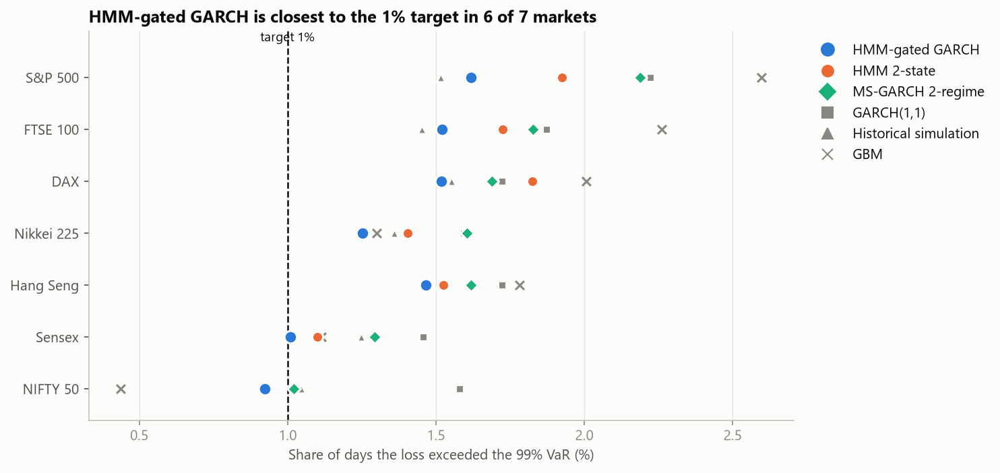

| Market | GBM | GARCH | HMM | MS-GARCH | HMM-gated GARCH | Hist. sim |
|---|---|---|---|---|---|---|
| S&P 500 | 2.60 | 2.22 | 1.93 | 2.19 | **1.62** | 1.52 |
| FTSE 100 | 2.26 | 1.87 | 1.73 | 1.83 | **1.52** | 1.45 |
| DAX | 2.01 | 1.72 | 1.82 | 1.69 | **1.52** | 1.55 |
| Nikkei 225 | 1.30 | 1.59 | 1.41 | 1.60 | **1.25** | 1.36 |
| Hang Seng | 1.78 | 1.72 | 1.52 | 1.62 | **1.47** | 1.51 |
| Sensex | 1.11 | 1.46 | 1.10 | 1.29 | **1.01** | 1.25 |
| NIFTY 50 | 0.44 | 1.58 | 0.92 | 1.02 | 0.92 | 1.05 |

- Passing both Kupiec and Christoffersen at 5%: HMM in 2 markets (NIFTY,
  Sensex), MS-GARCH and HMM-gated GARCH in 1 (NIFTY), all other models in 0.
- On the five markets with data from 1990, no model passes. Every model
  is too narrow (1.25-2.6% violations). A normal distribution cannot produce
  tails heavy enough for 1990s + 2008 + 2020 together; fat-tailed errors would
  be the fix and are outside the course syllabus. NIFTY's pass is partly a
  shorter, gentler sample.
- On Sensex, HMM-gated GARCH has 1.01% violations (Kupiec p = 0.93) but fails
  Christoffersen independence (p = 0.036); the plain HMM passes both there.

## 2. Why HMM-gated GARCH beats the plain HMM

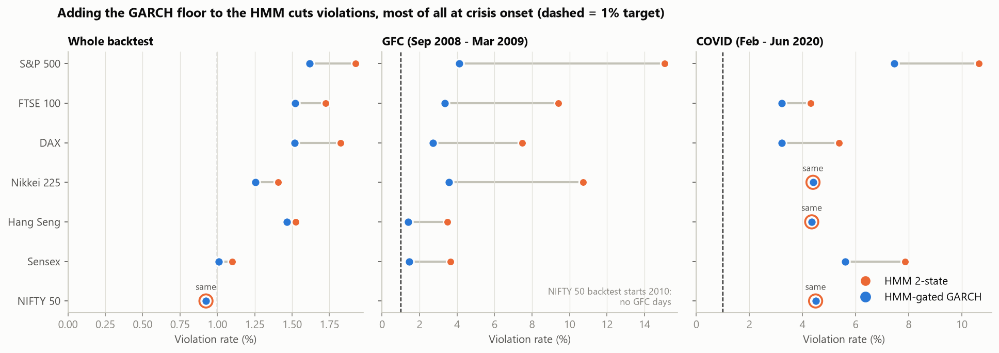

| Market | Violations (HMM -> gated) | GFC violations | COVID violations | Diebold-Mariano p |
|---|---|---|---|---|
| S&P 500 | 169 -> 142 | 22 -> 6 | 10 -> 7 | 0.010 |
| FTSE 100 | 152 -> 134 | 14 -> 5 | 4 -> 3 | 0.014 |
| DAX | 161 -> 134 | 11 -> 4 | 5 -> 3 | 0.003 |
| Nikkei 225 | 120 -> 107 | 15 -> 5 | 4 -> 4 | 0.081 |
| Hang Seng | 131 -> 126 | 5 -> 2 | 4 -> 4 | 0.16 |
| Sensex | 74 -> 68 | 5 -> 2 | 7 -> 5 | 0.16 |
| NIFTY 50 | 38 -> 38 | n/a | 4 -> 4 | 0.33 |

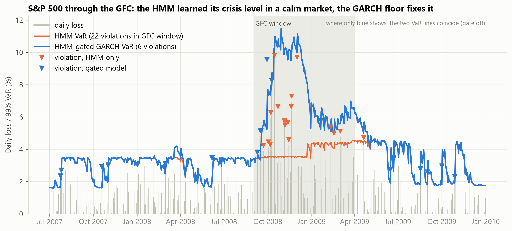

The HMM learns its crisis-regime volatility from history. Before 2008 the
S&P 500 had five calm years, so the HMM's crisis level was too low when the
GFC hit (its VaR stays flat around 3.5% in autumn 2008). The gate takes the
larger of that level and GARCH's current volatility, so VaR rises with the
crash. On NIFTY the gate only fired during COVID, which is why the two models
were identical in the single-market study.

The gate can only widen VaR, but this is not just extra caution: a VaR that
is wider everywhere has a worse tick loss, while the gated model's tick
loss is lower than the HMM's in all seven markets (significant in 3).

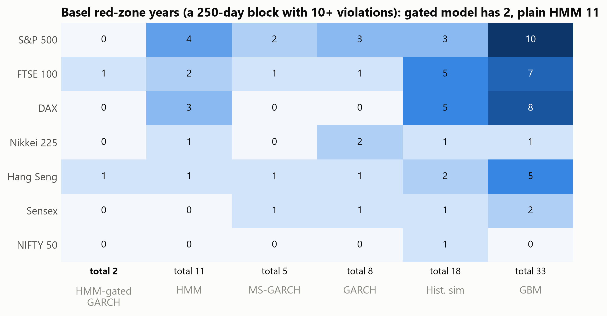

Basel red-zone years in total: HMM-gated GARCH 2, MS-GARCH 5, GARCH 8, HMM
11, historical simulation 18, GBM 33.

## 3. Forecasting power (quantile / tick loss, tau = 0.01)

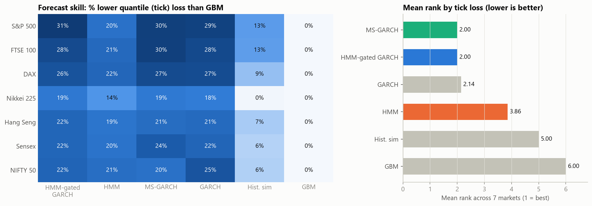

| Model | Skill vs GBM | Mean rank (1 = best) |
|---|---|---|
| MS-GARCH 2-regime | 20-30% | 2.00 |
| HMM-gated GARCH | 19-31% | 2.00 |
| GARCH(1,1) | 18-29% | 2.14 |
| HMM 2-state | 14-22% | 3.86 |
| Historical simulation | 0-13% | 5.00 |
| GBM | baseline | 6.00 |

GARCH is sharp but too narrow (never passes coverage); the HMM is correctly
wide but coarse. HMM-gated GARCH is the only model near the top on both.

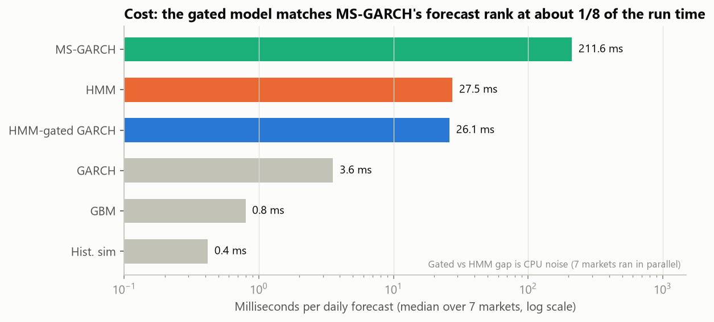

Total compute across all seven markets: MS-GARCH 201 min (80% of the run),
HMM 24 min, HMM-gated GARCH 23 min, GARCH 3.2 min, GBM 0.7 min, historical
simulation 0.5 min. The seven markets ran in parallel on one machine, so
times include CPU contention.

## 4. The regimes

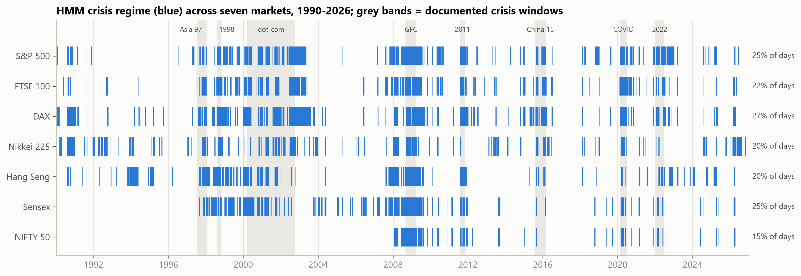

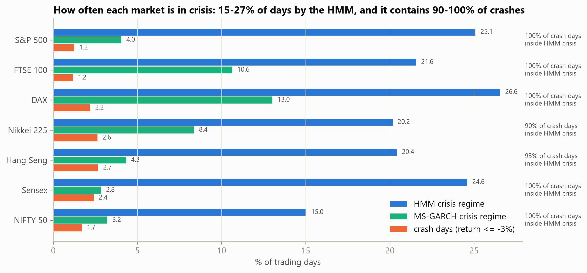

| Market | Crash days (<= -3%) | HMM crisis % of days | MS-GARCH crisis % | Crash days inside HMM crisis | HMM calm / crisis daily vol |
|---|---|---|---|---|---|
| S&P 500 | 1.2% | 25.1% | 4.0% | 100% | 0.68% / 1.93% |
| FTSE 100 | 1.2% | 21.6% | 10.6% | 100% | 0.70% / 1.88% |
| DAX | 2.2% | 26.6% | 13.0% | 100% | 0.86% / 2.23% |
| Nikkei 225 | 2.6% | 20.2% | 8.4% | 90% | 1.06% / 2.56% |
| Hang Seng | 2.7% | 20.4% | 4.3% | 93% | 1.05% / 2.73% |
| Sensex | 2.4% | 24.6% | 2.8% | 100% | 0.86% / 2.41% |
| NIFTY 50 | 1.7% | 15.0% | 3.2% | 100% | 0.82% / 2.65% |

Every market splits into a calm and a crisis regime, with the crisis regime
2.4-3.2x as volatile. The HMM's crisis regime covers 87-100% of the GFC window
in every market and 71-97% of 1998 Russia/LTCM. MS-GARCH's crisis regime is a
rare extreme-day state (3-13% of days), not a crisis period.

### Regime transition matrices

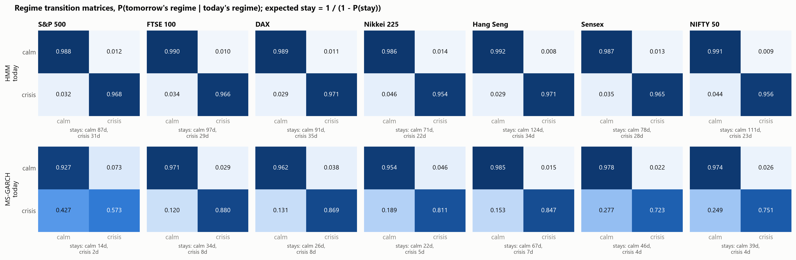

P[i, j] = P(regime j tomorrow | regime i today), from full-sample fits.
Expected stay in a regime = 1 / (1 - P(stay)).

| Market | HMM P(calm->calm) | HMM P(crisis->crisis) | HMM expected calm / crisis stay (days) | MS-GARCH P(crisis->crisis) | MS-GARCH expected crisis stay (days) | HMM switches per year (daily flags) |
|---|---|---|---|---|---|---|
| S&P 500 | 0.989 | 0.968 | 87 / 31 | 0.573 | 2.3 | 13.7 |
| FTSE 100 | 0.990 | 0.966 | 97 / 29 | 0.880 | 8.4 | 11.0 |
| DAX | 0.989 | 0.971 | 91 / 35 | 0.869 | 7.6 | 12.4 |
| Nikkei 225 | 0.986 | 0.954 | 71 / 22 | 0.811 | 5.3 | 13.2 |
| Hang Seng | 0.992 | 0.971 | 124 / 34 | 0.847 | 6.5 | 10.4 |
| Sensex | 0.987 | 0.965 | 78 / 28 | 0.723 | 3.6 | 14.2 |
| NIFTY 50 | 0.991 | 0.956 | 111 / 23 | 0.751 | 4.0 | 9.7 |

- Both HMM regimes are persistent in every market. The HMM transition
  matrix is very similar across markets: calm lasts about 3-5 months on
  average, crisis about 1-1.5 months, and the implied long-run crisis share
  (17-28%) matches the observed crisis-day share.
- MS-GARCH's crisis regime is short-lived (expected stay 2-8 days), which
  confirms it captures extreme days rather than crisis periods.
- The daily filtered flags switch about 10-14 times a year, more often than
  the fitted matrix implies, because single noisy days push P(crisis) across
  0.5. That is why crisis spells are merged across short gaps when measuring
  crisis length.
- Full numbers (fitted and empirical, both models): `ALL_transition_matrices.csv`.

### Chapman-Kolmogorov check

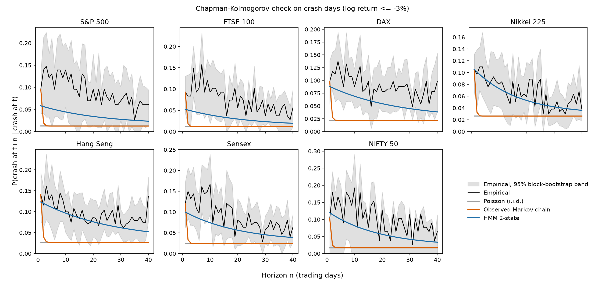

For a Markov chain, the n-step transition matrix must equal P^n. We compare
each model's n-step prediction with the empirical n-step frequency at
horizons 1-40 trading days. A model passes at a horizon if its value is inside
the 95% moving-block-bootstrap band of the empirical value (250-day blocks,
1,000 replications). Fits are full sample, so this is a goodness-of-fit check.

Crash days, P(crash at t+n | crash at t), horizons passed out of 40:

| Market | Poisson | Observed Markov chain on crash flag | HMM 2-state |
|---|---|---|---|
| S&P 500 | 19 | 20 | 39 |
| FTSE 100 | 12 | 14 | 34 |
| DAX | 3 | 4 | 35 |
| Nikkei 225 | 20 | 21 | 39 |
| Hang Seng | 6 | 7 | 39 |
| Sensex | 17 | 18 | 37 |
| NIFTY 50 | 38 | 38 | 39 |
| All (of 280) | 115 (41%) | 122 (44%) | 262 (94%) |

- After a crash, the chance of another crash averages 8-13% over the next
  20 days, against a 1-3% base rate (3-9x). The observed chain's memory dies
  within 2-3 days; the hidden regime chain reproduces the slow decay.
- NIFTY cannot discriminate (short sample, crashes concentrated in 2008-09,
  bootstrap band reaches 0). Excluding NIFTY: HMM 223/240, chain 84/240,
  Poisson 77/240.
- The HMM's curve sits below the empirical one in the Western markets: normal
  errors give crash days too little probability, the same thin-tail problem
  that breaks VaR coverage.

Regime flags, P(same regime at t+n | regime at t): the flags' own one-step
matrix passes only 69 of 560 horizon checks (calm + crisis), because single
noisy days flip the daily flags. The HMM's fitted matrix passes 420 of 560
(75%), failing mainly at n = 1-5. This is why crisis spells are merged across
short gaps in the length study. Files: `CK_crash_days.csv`,
`CK_regime_flags.csv`, `CK_summary.csv`.

## 5. Do the crisis labels match real crises?

Labels are full-sample (in-sample) fits, so this section is descriptive; the
real-time evidence is the VaR backtest above.

Yardsticks, fixed before looking at the labels:
- Bear markets from each market's own prices, 20%-down / 20%-up rule (83 in total).
- NBER US business-cycle dates (nber.org/research/data/us-business-cycle-expansions-and-contractions).
- Event dates: Thai baht devaluation 2 Jul 1997 (Federal Reserve History,
  "Asian Financial Crisis"); Russian default 17 Aug 1998 (Chicago Fed
  Economic Perspectives, 2001 Q1); LTCM recapitalisation 23 Sep 1998 (FRBNY
  1998 Annual Report); WHO pandemic declaration 11 Mar 2020.

Timing (start):
- Median HMM start is 8 trading days after a bear-market peak; 54% are flagged
  within 10 days and 70% within 30.
- Sudden crashes are caught fast: COVID S&P 500 / DAX +3 days, 1998 FTSE +2 /
  DAX +5, GFC S&P 500 / DAX +8.
- The HMM was already in crisis before the WHO declaration in all 7 markets
  (by 2-12 trading days) and before the LTCM rescue in 5 of 6. This is
  detection, not prediction: markets were already falling.
- NBER recessions flagged: 2001 53%, 2007-09 82%, 2020 100%.
- Overlap with bear-market days: recall 30-65%, precision 30-51%,
  correlation of P(crisis) with being in a bear 0.20-0.37 (MS-GARCH recall 6-23%).

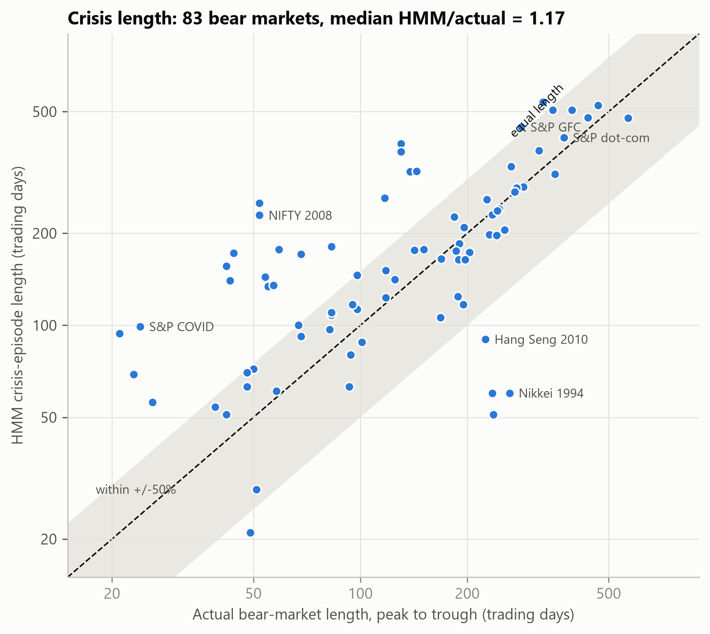

Length (crisis spells merged across gaps of up to 5 trading days):
- Median bear length 130 trading days, median HMM episode 164 days
  (median ratio 1.17); 65% of bears within +/-50%; rank correlation 0.67.
- The HMM ends a median 33 trading days after the price trough: volatility
  stays high during the rebound, so a volatility regime correctly lingers.
- NBER 2007-09: HMM 4 Jan 2008 - 27 Jul 2009, 393 days against 377 (4% off).
  NBER 2001: 154 against 166 days (7% short).
- COVID crash (21-24 days peak to trough for S&P 500 / DAX) gets a 94-99 day
  episode: about 4x too long, because volatility stayed high until July 2020.
- Slow, low-volatility bears are missed: Nikkei 1994-95 (60 of 263 days),
  Hang Seng 2010-11 (90 of 225).
- MS-GARCH's apparent length match is an artifact: it flags only 2-14% of
  days inside a crisis, so a few scattered flags span the whole window.

## 6. What carries over and what does not

- Carries over to every market: the calm/crisis regime structure, its link to
  documented crises and crash days, and the ranking of the models. HMM-gated
  GARCH has the fewest violations in 6 of 7 markets, the fewest Basel red years,
  and ties for the best forecast rank.
- Does not carry over: correct 1% coverage. With normal errors, no model gets
  it right over 30+ years of data.

## Files

- `ALL_backtest.csv`: per market x model: violations, Kupiec / Christoffersen
  p-values, Basel zones, pre-2008 / GFC / post-GFC / COVID sub-periods
- `ALL_forecast_skill.csv`: tick loss, skill vs GBM, rank, Diebold-Mariano vs HMM
- `ALL_timings.csv`: seconds and ms per forecast for each model run
- `ALL_regimes.csv`, `ALL_crisis_windows.csv`: regime summary and crisis-window coverage
- `ALL_transition_matrices.csv`: fitted and empirical transition matrices
- `VALIDATION_bear_markets.csv`, `VALIDATION_overlap.csv`, `VALIDATION_events.csv`,
  `VALIDATION_crisis_duration.csv`: crisis-timing and crisis-length checks
- `<market>_var_paths.csv`: daily VaR and hit series for every model
- `<market>_regime_flags.csv`: daily regime labels
- `cache/`: per-model backtest tables and run times

Reproduce:

```
python -m src.multi_market --download
python -m src.multi_market --market sp500      # one market; repeat for each
python -m src.multi_market --aggregate
python -m src.crisis_validation
python -m src.crisis_duration
python -m src.regime_transitions
python -m src.chapman_kolmogorov
python -m src.make_multi_market_figures
```
